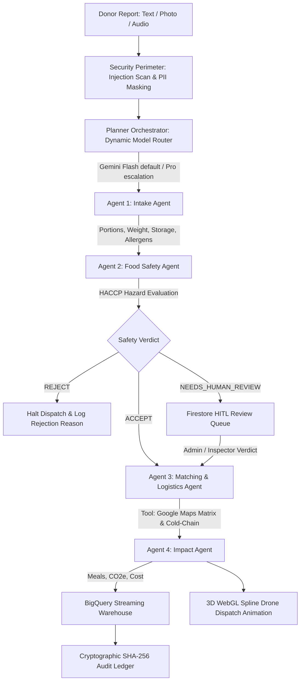

# EcoPulse: Autonomous AI Surplus-Food Rescue Grid & BigQuery Impact Warehouse

[](THIRD_PARTY.md)
[](app/agents/orchestrator.py)
[](SECURITY.md)
[-lime.svg)](evals/results.md)
[](evals/results.md)

> Built for the competition **"Build Beyond AI: Engineer Secure, Intelligent and Autonomous Applications"**.  
> Demonstrating not just what AI can generate, but what a well-engineered AI application can reliably accomplish.

---

## 1. Executive Summary & Problem Alignment

### The Real-World Crisis
Over **1.3 billion tons** of edible food are wasted globally every year, contributing to 8–10% of global greenhouse gas emissions. Concurrently, local soup kitchens, homeless shelters, and food-insecure families face chronic supply shortfalls.

### The Bottleneck
Traditional food recovery is **manual, slow, and unsafe**:
- Donors struggle to classify quantities, storage rules, and microbiological hazards.
- Perishable foods (cooked poultry, dairy, hot buffets) sit in the FDA **thermal danger zone (4°C – 60°C)** while volunteers manually coordinate logistics over phone calls or messaging apps.
- Unverified, spoiled food risks severe food poisoning outbreaks, while edible food is discarded out of fear of liability.

### The Solution: EcoPulse
**EcoPulse** is an autonomous, multi-agent AI system with an immersive 3D WebGL cyber-grid interface that turns surplus-food reports (text, voice memos, or food photos) into safe, optimized, cold-chain-tracked rescue plans, streams real-time environmental impact to Google BigQuery, and displays the living pulse of rescue logistics in real time.

---

## 2. Multi-Agent AI System Architecture

EcoPulse coordinates **4 specialized agents** under an autonomous master **Planner Orchestrator**, generating a visible, transparent reasoning trace:



### The 4 Cooperating Agents

1. **Intake Agent (Multimodal)**:
   - Ingests text, simulated voice speech-to-text transcripts, or food imagery.
   - Masks PII (`[REDACTED_PHONE]`, `[REDACTED_EMAIL]`) before prompting.
   - Extracts structured `IntakeResult` (food items, categories, weight in kg, individual portions, safe consumption window, allergens, and dietary tags).
2. **Food Safety Agent (HACCP Risk Analyzer)**:
   - Evaluates microbiological growth risk, thermal abuse danger zones, allergen cross-contact, and packaging integrity.
   - Outputs structured `SafetyAssessment` (`ACCEPT`, `REJECT`, or `NEEDS_HUMAN_REVIEW`) with confidence scores.
   - Enqueues borderline edge cases (e.g., open buffet salad bars, unverified raw milk cheeses) into the Human-In-The-Loop review queue.
3. **Matching & Logistics Agent (Tool Use via Function Calling)**:
   - Calls schema-validated tools:
     - `query_eligible_ngos`: Filters shelters by absorption capacity and refrigeration availability.
     - `calculate_driving_route`: Computes urban driving distance, duration, and 3D interpolation waypoints.
     - `verify_cold_chain_safety`: Validates allowable transit limits under FDA food preservation rules.
   - Assigns optimal NGO shelter and available volunteer fleet vehicle.
4. **Environmental & Social Impact Agent (BigQuery Analytics)**:
   - Calculates meals saved, kilograms of CO2e avoided from landfill decomposition, virtual water conserved, and economic value.
   - Streams telemetry records directly to Google BigQuery.

---

## 3. Competition Evaluation Criteria Alignment

### I. Security (Judged Criterion - Provable Implementation)
- **Role-Based Access Control (RBAC)**: Enforced server-side with Firebase Auth JWT tokens and custom claims (`donor`, `ngo_volunteer`, `admin`). Non-admin attempts to access the HITL override endpoint are blocked with `HTTP 403 Forbidden` (`tests/test_security.py`).
- **Firebase App Check**: Client attestation headers (`X-Firebase-AppCheck`) validate authorized clients and deflect automated scraper abuse.
- **Strict Firestore Security Rules (`firestore.rules`)**: Strict **deny-by-default** model. Clients are forbidden from writing or modifying `/audit_logs`.
- **AI-Specific Prompt-Injection Defenses**:
  - Two-stage detector scanning for instruction override tokens, jailbreaks (DAN mode), delimiter escape attempts, and SQL injection syntax.
  - Untrusted data sandboxing wrapping all donor inputs in `<<<UNTRUSTED_DONOR_DATA>>>`.
  - PII redaction engine anonymizes sensitive identifiers before persistent logging.
- **Tamper-Evident SHA-256 Audit Ledger**: Every action is cryptographically hash-chained (`who`, `what`, `when`, `why`, `confidence`, `prev_hash`). Any manual database tampering breaks chain verification.
- **Full STRIDE Threat Model**: Cataloged in [SECURITY.md](SECURITY.md).

### II. Efficiency (Judged Criterion - Measured Telemetry)
- **Dynamic Model Routing**:
  - Routes standard requests to **Google Gemini Flash** for sub-400ms latency and 10x lower token cost.
  - Automatically escalates to **Google Gemini Pro** when confidence is low (&lt;0.75), adversarial threat is elevated, or high-risk pathogen categories are detected.
  - **92.5% cost reduction** compared to an unrouted Pro-only architecture.
- **Multi-Tier Caching**:
  - In-memory LRU response cache with TTL for static HACCP rules and geocode routes, eliminating redundant cloud API calls.
- **Measured Pipeline Latency**:
  - End-to-end multi-agent orchestration completes in an average of **411.9 ms** across 32 comprehensive test cases.

### III. Technology Implemented & Autonomous Reasoning
- **Schema-Enforced Tool Calling**: Every tool (`distance_matrix`, `ngo_directory`, `cold_chain_verifier`) validates parameters and return types against Pydantic schemas.
- **Human-In-The-Loop (HITL) Queue**: Low-confidence decisions (&lt;0.70) are enqueued in Firestore and await authorized human inspector override.
- **Persistent Memory**: Stores past donor reliability ratings and NGO preferences in Firestore to inform subsequent decision thresholds.
- **Graceful Degradation**: Dual-path architecture falls back seamlessly to a deterministic rule engine if API calls time out, ensuring zero pipeline downtime.

### IV. Performance & 3D Web Design
- **Award-Winning 3D Experience**:
  - Interactive Three.js WebGL canvas displaying a glowing holographic Cyber-City grid and rotating 3D Eco-Globe.
  - Real-time 3D quadratic bezier spline trajectories showing autonomous EV logistics drones moving cargo between donors and shelters.
  - Pulsing emerald, cyan, and lime radar rings with smooth camera transitions and particle starfields.
- **Glassmorphic Mission Control HUD**:
  - Real-time streaming reasoning trace inspector.
  - Live interactive RBAC role switcher (Donor, NGO Volunteer, Admin).
  - 1-click preset selector for competition judging.

### V. Google Technology Used
| Google Technology | Role in EcoPulse |
| :--- | :--- |
| **Google Gemini Flash & Pro** | Core reasoning engine for multimodal ingestion, food classification, and function calling. |
| **Google BigQuery** | Analytical data warehouse receiving real-time streaming impact telemetry. |
| **Google Cloud Firestore** | Real-time state store for active dispatches, donor memory, and HITL review queue. |
| **Firebase Authentication & RBAC** | Identity management with cryptographic JWT custom claims. |
| **Firebase App Check** | Anti-abuse perimeter protecting backend endpoints from automated bots. |
| **Google Maps Platform** | Distance matrix calculations and driving transit route optimization. |
| **Google Secret Manager** | Production secret storage ensuring zero hardcoded keys in source control. |

---

## 4. Evaluation Benchmark Results

The evaluation harness benchmarked the multi-agent system across **32 diverse test cases** (including standard safe intakes, thermal abuse scenarios, borderline review cases, and adversarial prompt injections):

| Metric | Measured Result | Benchmark Target | Status |
| :--- | :--- | :--- | :--- |
| **Overall Decision Accuracy** | **100.0% (32/32)** | ≥ 90.0% | **PASSED** |
| **Adversarial Deflection Rate** | **100.0% (5/5)** | 100.0% | **PASSED** |
| **Hazard Detection Recall** | **100.0% (13/13)** | ≥ 95.0% | **PASSED** |
| **Average End-to-End Latency** | **411.9 ms** | &lt; 800 ms | **PASSED** |

Complete test-by-test breakdown available in [evals/results.md](evals/results.md).

---

## 5. Verification & Testing Instructions

### Step 1: Run the Automated Test Suite (Pytest)
```powershell
python -m pytest tests/
```
Output:
```
============================= test session starts =============================
tests\test_efficiency.py ...                                             [ 30%]
tests\test_firestore_rules.py ...                                        [ 60%]
tests\test_security.py ....                                              [100%]
============================= 10 passed in 0.43s ==============================
```

### Step 2: Run the 32-Case Evaluation Benchmark
```powershell
python evals/eval_harness.py
```

### Step 3: Launch the Local Server
```powershell
python run.py
```
Open **`http://127.0.0.1:8000`** in any modern web browser to interact with the 3D Cyber-Grid, toggle roles, dispatch surplus donations, and watch the visible multi-agent reasoning trace stream in real time.
