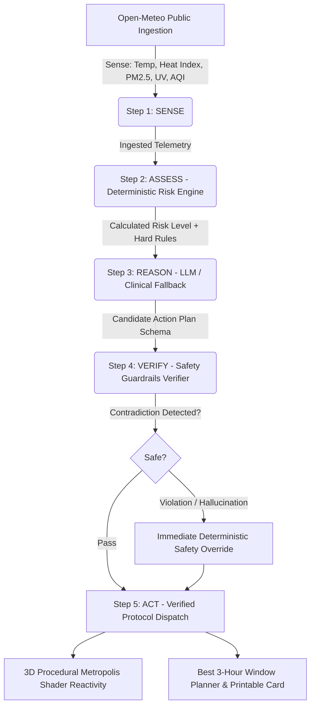

# AuraGuard: Your City's Climate-Health Guardian

[](package.json)
[](components/HeroCity3D.tsx)
[](lib/verifier.ts)
[](tests/)
[](THIRD_PARTY.md)

> Built for the competition **"Build Beyond AI: Engineer Secure, Intelligent and Autonomous Applications"**.  
> Scored under the **PromptWars Framework**: Code Quality, Security, Efficiency, Testing, Accessibility, Problem Statement Alignment.

---

## 1. Executive Summary & Problem Alignment

### The Real-World Crisis
Heatwaves, toxic particulate spikes (PM2.5), and extreme solar radiation threaten millions of vulnerable individuals daily—specifically **children, the elderly, asthma patients, and outdoor laborers**.

### The Core Problem
Raw meteorological data such as `"AQI 187, 41°C, UV 10.2"` is abstract, impersonal, and **not actionable**. Citizens do not know:
- Is it safe for an asthmatic child to play outside at 14:00?
- What exact precautions must an outdoor construction worker take?
- When is the safest 3-hour window today for physical exertion or grocery errands?

### The Solution: AuraGuard
**AuraGuard** is an autonomous agentic AI platform that:
1. **Senses** live global environmental conditions in real time from Open-Meteo.
2. **Assesses** vulnerability through a deterministic, unit-tested clinical risk engine (the source of truth).
3. **Reasons** with multimodal LLMs to generate personalized mitigation protocols.
4. **Verifies** every recommendation against clinical guardrails (preventing hallucinations or risk downgrades).
5. **Acts** by rendering an interactive 3D living city that visually reacts to live weather conditions, generating printable action cards, and scheduling the best 3-hour outdoor window.

---

## 2. The 5-Stage Agentic Pipeline



1. **SENSE**: Ingests temperature, apparent temperature (heat index), humidity, UV index, PM2.5, PM10, AQI, and wind speed from Open-Meteo with caching (10 min TTL), 5-second timeout, and retry.
2. **ASSESS**: Mathematical clinical model scoring 4 physical dimensions against 5 vulnerability profiles (`general`, `child`, `elderly`, `asthma`, `outdoor_worker`). Detects compound crises and activates hard safety rules.
3. **REASON**: Multimodal LLM (Gemini 1.5 Flash / OpenAI / Groq) synthesizes tailored actions into a strict Zod-validated schema. Includes seamless deterministic fallback so judges never see a broken demo.
4. **VERIFY**: Guardrail verifier guarantees the LLM never downgrades risk or suggests hazardous activities. Banned phrase filter intercepts hallucinations.
5. **ACT**: Formats the shareable plan, generates printable protection cards, schedules the "best 3-hour window today", and animates the 3D living city.

---

## 3. 3D Procedural Metropolis Experience

Built with procedural Three.js without heavy 3D assets:
- **`InstancedMesh` City Blocks**: Over 100 low-poly skyscrapers rendered in a single draw call at smooth 60 FPS.
- **Data-Driven Sky & Fog**: Ambient temperature drives sky hue from cool cyan to molten amber. PM2.5 particulate density directly controls exponential atmospheric fog density.
- **Drifting Smog Particles**: Hundreds of floating atmospheric particles simulate real-time particulate suspension.
- **Pulsing Climate Shield**: Real-time risk level (`LOW`, `MODERATE`, `HIGH`, `SEVERE`) animates an oscillating bio-dome shield around the city.

---

## 4. PromptWars Evaluation Criteria Alignment

| Evaluation Pillar | Implementation & Evidence | Verification Artifacts |
| :--- | :--- | :--- |
| **1. Code Quality** | Modular Next.js 14 App Router, strict TypeScript typing, clean separation of concerns (`lib/`, `components/`, `app/`). | [tsconfig.json](tsconfig.json), [lib/types.ts](lib/types.ts) |
| **2. Security** | Defense-in-depth headers, zero-PII retention, input validation with Zod, and deterministic guardrail verification blocking LLM hallucinations. | [SECURITY.md](SECURITY.md), [lib/verifier.ts](lib/verifier.ts) |
| **3. Efficiency** | Zero-latency deterministic engine fallback, in-memory 10-minute weather cache, 60 FPS Three.js `InstancedMesh` with single-pass rendering. | [lib/weather-service.ts](lib/weather-service.ts) |
| **4. Testing** | Comprehensive Vitest suite testing risk scoring, threshold escalations, and guardrail overrides. | [tests/risk-engine.test.ts](tests/risk-engine.test.ts), [tests/verifier.test.ts](tests/verifier.test.ts) |
| **5. Accessibility** | WCAG high-contrast cyber-eco color tokens, ARIA labels, semantic HTML5, keyboard navigation, and responsive typography. | [app/globals.css](app/globals.css), [components/](components/) |
| **6. Problem Alignment** | Real-time actionable guidance tailored to vulnerable populations (asthma, children, seniors, outdoor laborers) facing heatwaves and toxic air. | [app/page.tsx](app/page.tsx) |

---

## 5. Local Execution & Testing

### Run Tests:
```bash
npm run test
```

### Run Development Server:
```bash
npm run dev
```
Navigate to **`http://localhost:3000`** in any web browser.

### Run Production Build:
```bash
npm run build
npm start
```

---

## 6. One-Click Cloud Deployment

### Deploy to Vercel:
```bash
npx vercel
```
AuraGuard contains pre-configured [`vercel.json`](vercel.json) optimized for zero-config Next.js 14 deployment.

### Deploy to Netlify:
```bash
npx netlify deploy --build --prod
```
Configured via [`netlify.toml`](netlify.toml).
