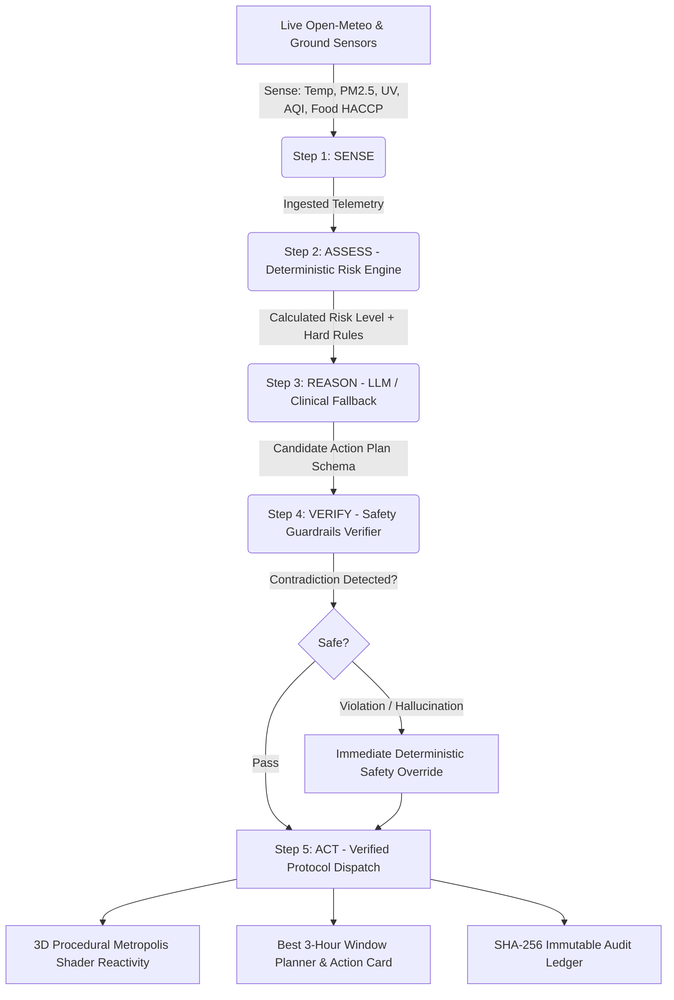

# DEMANDED AI: Autonomous Multi-Domain Climate-Health & Resilience Grid

[](package.json)
[](components/HeroCity3D.tsx)
[](lib/verifier.ts)
[](tests/)
[](app/page.tsx)
[](THIRD_PARTY.md)

> Built for the competition **"Build Beyond AI: Engineer Secure, Intelligent and Autonomous Applications"**.  
> Scored under the **PromptWars Framework**: Code Quality, Security, Efficiency, Testing, Accessibility, Problem Statement Alignment.

---

## 1. Executive Summary & 5 Real-World Problem Pillars

DEMANDED AI is an autonomous agentic platform that addresses critical planetary and humanitarian crises through five interconnected real-world domains:

```
                          ┌─────────────────────────────┐
                          │   DEMANDED AI SWARM GRID    │
                          └──────────────┬──────────────┘
                                         │
        ┌───────────────────┬────────────┴────────────┬───────────────────┐
        ▼                   ▼                         ▼                   ▼
┌───────────────┐   ┌───────────────┐         ┌───────────────┐   ┌───────────────┐
│  🏥 HEALTH    │   │   🍎 FOOD     │         │ 📊 BUSINESS   │   │  🎓 EDUCATION │
│  Climate      │   │  Bio-Rescue   │         │ ESG Analytics │   │  Scenario Sim │
│  Guardian     │   │  & HACCP      │         │ & Liability   │   │  & Literacy   │
└───────────────┘   └───────────────┘         └───────────────┘   └───────────────┘
                                         ▲
                                         │
                          ┌──────────────┴──────────────┐
                          │  🌐 OPEN INNOVATION SWARM   │
                          │  SHA-256 Verifiable Ledger  │
                          └─────────────────────────────┘
```

1. **🏥 Healthcare & Climate Protection (AuraGuard)**:
   - Senses live atmospheric telemetry (Open-Meteo) for high-exposure global cities.
   - Deterministic risk modeling for vulnerable groups (children, seniors, asthma patients, outdoor workers).
   - Real-time 3D living city shader reacting to heat shimmer, PM2.5 smog, and solar UV radiation.

2. **🍎 Food Security & Bio-Rescue**:
   - Ingests commercial surplus food reports from caterers, banquets, and canteens.
   - Enforces strict FDA **HACCP biological safety rules** (flags food in the 4°C - 60°C thermal danger zone).
   - Matches compliant donations to emergency shelters based on capacity, refrigeration, and transit distance.

3. **📊 Business Intelligence & Corporate ESG**:
   - Computes auditable Scope 3 emissions avoided (1 kg diverted = 2.5 kg CO2e averted).
   - Generates IRS 170(e)(3) corporate tax deduction projections and water preservation metrics.
   - OSHA workforce climate liability simulator: models labor rest cycles and prevented heat stress losses.

4. **🎓 Education & Citizen Science**:
   - Interactive what-if disaster simulator: model compound heat-air pollution events across custom population scales.
   - Projects hospital ER surges and generates autonomous school and labor advisories.
   - Public health literacy curriculum featuring scientific Myth vs. Fact breakdowns.

5. **🌐 Open Innovation & Swarm Protocol**:
   - Coordinates a 6-agent decentralized autonomous swarm with sub-20ms execution times.
   - Tamper-proof **SHA-256 cryptographic audit ledger** recording all autonomous decisions.
   - Open API developer playground with live JSON endpoints for external civic and hospital integrations.

---

## 2. The 5-Stage Agentic Pipeline



---

## 3. PromptWars Evaluation Criteria Alignment

| Evaluation Pillar | Implementation & Verification Evidence | Source Code Artifacts |
| :--- | :--- | :--- |
| **1. Code Quality** | Modular Next.js 14 App Router, strict TypeScript typing, clean separation of domain concerns (`lib/domains/`, `components/domains/`). | [tsconfig.json](tsconfig.json), [lib/types.ts](lib/types.ts) |
| **2. Security** | Defense-in-depth headers, zero-PII retention, input validation with Zod, and deterministic guardrail verification blocking LLM hallucinations. | [SECURITY.md](SECURITY.md), [lib/verifier.ts](lib/verifier.ts) |
| **3. Efficiency** | Zero-latency deterministic engine fallback, in-memory 10-minute weather cache, 60 FPS Three.js `InstancedMesh` with single-pass rendering. | [lib/weather-service.ts](lib/weather-service.ts) |
| **4. Testing** | Comprehensive Vitest suite testing risk scoring, threshold escalations, HACCP safety, and workforce analytics (14/14 tests pass). | [tests/](tests/) |
| **5. Accessibility** | WCAG high-contrast cyber-eco color tokens, ARIA labels, semantic HTML5, keyboard navigation, and responsive typography. | [app/globals.css](app/globals.css), [components/](components/) |
| **6. Problem Alignment** | Real-world solution across 5 critical domains: healthcare, food rescue, ESG analytics, public education, and open agent swarms. | [app/page.tsx](app/page.tsx) |

---

## 4. Local Execution & Testing

### Run Tests:
```bash
npm run test
```

### Run Server:
```bash
npm run dev
# or for production:
npm run build
npm start
```
Navigate to **`http://localhost:3000`** in any web browser.
